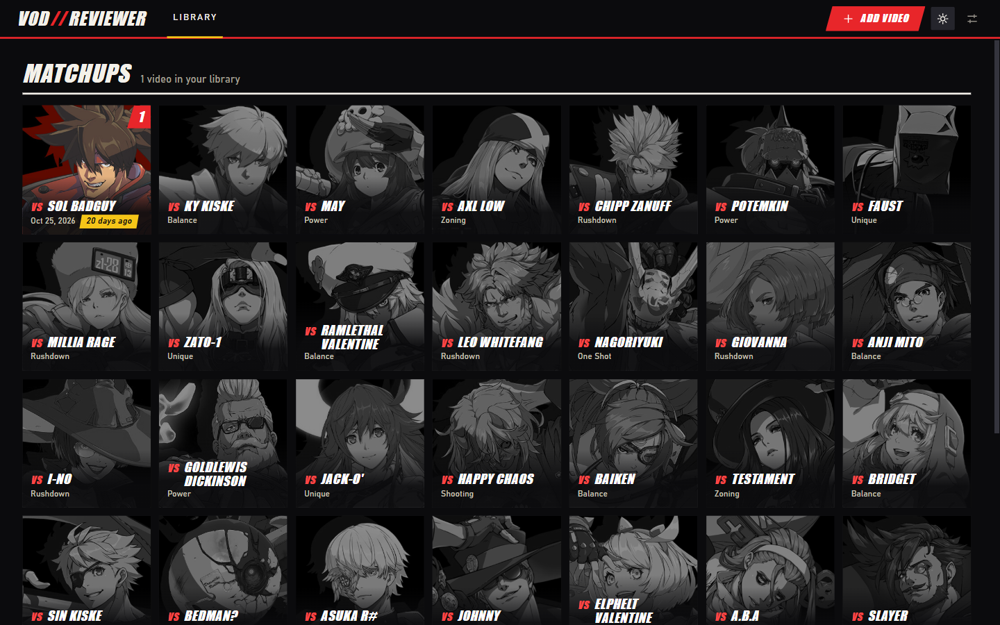
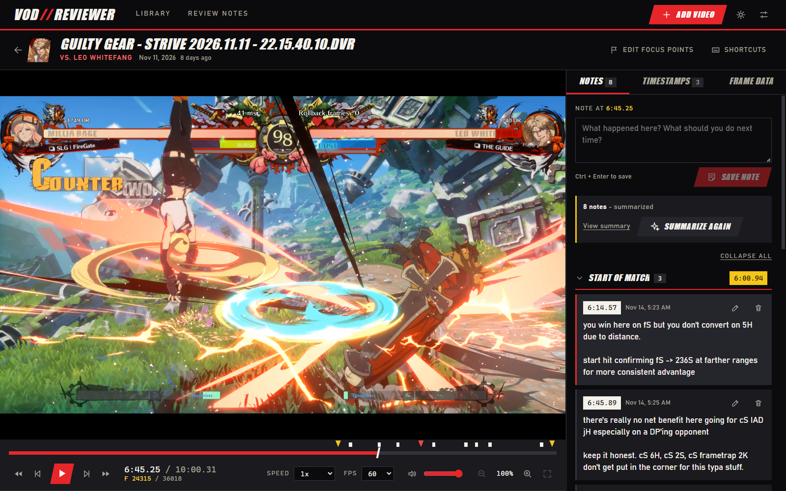

# VOD Reviewer

A desktop app for fighting game players who review their own matches. Add a recording,
file it under the matchup you played, mark the moments that matter, then break them down
frame by frame with notes and clickable timestamps.

Built around **Guilty Gear -Strive-**: every character has a matchup folder, and the
interface wears the game's colours in light and dark mode.





## Features

- **Import from your Videos folder.** Browse it (and its sub-folders) inside the app and
  preview a recording before adding it. Videos are referenced where they are - nothing is
  copied, and removing a video from the library never deletes the file.
- **Matchup folders.** One per character (34, through Season Pass 5), each with its
  portrait, plus your own custom folders. Move and rename videos at any time.
- **Dates with an "old video" highlight.** Every video shows when it was recorded;
  anything older than 15 days (configurable) is flagged in yellow.
- **Frame-by-frame.** Step one or ten frames in either direction anywhere in the video.
  The recording's frame rate is detected automatically and can be overridden.
- **Zoom and pan.** Scroll to zoom towards the cursor (up to 8x), drag to pan.
- **Notes.** Pinned to the exact moment you started typing, saved instantly, and grouped
  by review session.
- **Timestamps.** Mark any moment, label it, and click it - in the list or on the
  timeline - to jump straight back.
- **Focus points.** Before reviewing, mark where the review should concentrate; the
  review opens on the first one.
- **Slow motion**, 0.1x to 2x.
- **Light and dark themes**, following the system by default.

## The workflow

1. **Add a video** - the app asks for one on first launch; later, use *Add video*.
2. **Choose the matchup** - pick the character you played against (or a custom folder).
3. **Mark focus points** - scrub through and flag the rounds or exchanges to study.
4. **Review** - the main workspace: player, notes and timestamps side by side.

Steps 3 and 4 can be reopened for any video from its folder.

## Install it as a desktop app

Requires [Node.js](https://nodejs.org) 22 or newer to build.

```bash
npm install
npm run package
```

Then run `dist\VOD-Reviewer-Setup-<version>.exe`. It installs for your user only (no
administrator prompt), adds **VOD Reviewer** to your desktop and Start menu, and opens the
app. From there you can pin it to the taskbar like any other program.

The installer is not code-signed, so Windows SmartScreen warns the first time: choose
*More info*, then *Run anyway*. To upgrade, build and run a newer installer; your library
is kept. Uninstalling keeps it too.

## Development

```bash
npm install
npm run dev      # run with hot reload
npm start        # build and run the production build
```

### Scripts

| Command | What it does |
| --- | --- |
| `npm run dev` | Start the app in development mode with hot reload |
| `npm start` | Build, then run the built app |
| `npm run build` | Type-check and build into `out/` |
| `npm run package` | Build the Windows installer into `dist/` |
| `npm run package:dir` | Build the unpacked app only (`dist/win-unpacked`), which is faster |
| `npm test` | Unit tests (Vitest) |
| `npm run test:e2e` | End-to-end smoke test of the built app (run `npm run build` first) |
| `npm run typecheck` | Strict TypeScript check of both processes |
| `npm run lint` | ESLint, type-aware |
| `npm run fetch:characters` | Re-download the character portraits (after a roster change) |
| `npm run make:icon -- <id>` | Regenerate the app icon from a character portrait (default `mll`, Millia Rage) |

## Keyboard shortcuts

| Keys | Action |
| --- | --- |
| `Space` | Play / pause |
| `,` / `.` | Previous / next frame |
| `Shift` + `,` / `.` | Back / forward 10 frames |
| `Left` / `Right` | Back / forward 1 second |
| `Shift` + `Left` / `Right` | Back / forward 5 seconds |
| `[` / `]` | Slower / faster |
| `+` / `-` / `0` | Zoom in / out / reset |
| Mouse wheel | Zoom towards the cursor |
| `M` | Add a timestamp (or focus point) at the current moment |
| `N` | Write a note at the current moment |
| `Ctrl` + `Enter` | Save the note being written |

The same list is available in the app under *Shortcuts*.

## Where your data lives

Everything the app knows is in one human-readable file:

```
%APPDATA%\vod-reviewer\library.json
```

It holds your folders, the videos you added (by path), timestamps, notes, review sessions
and settings. The installed app and a development run share this one file. Back it up or
sync it like any other file. Its structure, and how it maps
onto database tables, is documented in [docs/data-model.md](docs/data-model.md).

## Supported videos

MP4, M4V, MOV, WebM and MKV containers. Playback uses Chromium's decoders, so H.264, VP9
and AV1 work everywhere; HEVC depends on your hardware.

## Project structure

```
src/
  shared/       domain model, IPC contract - used by both processes
  main/         Electron main process: library file, IPC, video streaming
  preload/      the bridge between the two
  renderer/     the React app (features: library, import, focus, review, player, annotations)
docs/           architecture, data model + ERD, design system, decision records
scripts/        character art fetcher, icon generator, end-to-end smoke test
build/          installer resources (the app icon)
resources/      files the main process loads at runtime (the window icon)
```

## Documentation

- [Architecture](docs/architecture.md) - processes, data flow, the media player, testing
- [Data model](docs/data-model.md) - the JSON file, the ERD, and the path to a database
- [Design system](docs/design-system.md) - colours, type, shapes, conventions
- [Decision records](docs/decisions/README.md) - why things are the way they are

## Known limitations

- If a video file is moved, renamed or deleted outside the app, its library entry stops
  playing (the player says so). There is no re-link feature yet; remove and re-add it.
- Frame stepping assumes a constant frame rate, which is what OBS and ShadowPlay record.
  Until a new video has played for a second or two, 60 fps is assumed.
- The installer is Windows-only, unsigned, and has no auto-update.

## Credits

Guilty Gear -Strive- and its character artwork are (c) ARC SYSTEM WORKS. The portraits in
`src/renderer/src/assets/characters` come from the official site and are included because
this repository is private and the app is not distributed; the app icon is made from one. This is a fan-made tool with
no affiliation with Arc System Works.
