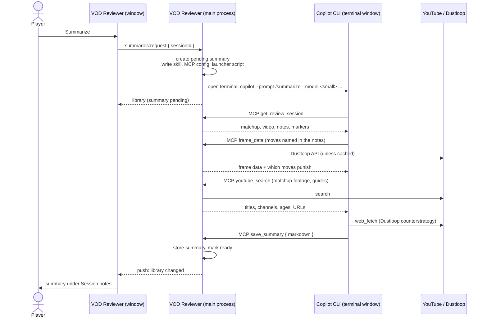

# The agent harness

Pressing **Summarize** in the notes panel turns the notes of a review session into a
coaching summary: recurring patterns, what went well, an action plan, and links to recent
high-level footage of the matchup and to guides for the skills that need work.

The writing is done by an AI agent - the **GitHub Copilot CLI**, running a skill called
`/summarize` on a small model in its own terminal window. The *harness* is everything
the app does around that agent: starting it, deciding what it can see and do, and taking
its result back.



## The pieces

| Piece | Where | Role |
| --- | --- | --- |
| The skill | [`resources/agent/skills/summarize/SKILL.md`](../resources/agent/skills/summarize/SKILL.md) | The agent's instructions: how to read the notes, what to research, the exact shape of the summary. This is the file to edit to change what summaries say. |
| The harness | [`src/main/agent/harness.ts`](../src/main/agent/harness.ts) | Starts runs and hosts the endpoint the agent talks to. |
| The tools | [`src/main/agent/tools.ts`](../src/main/agent/tools.ts) | `get_review_session`, `frame_data`, `youtube_search`, `save_summary`. |
| Frame data | [`src/main/framedata`](../src/main/framedata) | Dustloop lookup, local cache, and the punish calculation the tool prints. |
| The protocol | [`src/main/agent/mcp.ts`](../src/main/agent/mcp.ts) | A minimal Model Context Protocol server over loopback HTTP. |
| The launcher | [`src/main/agent/launcher.ts`](../src/main/agent/launcher.ts) | Builds the `copilot` command line and the batch file that runs it. |
| YouTube search | [`src/main/agent/youtube.ts`](../src/main/agent/youtube.ts) | Search without an API key, reduced to a few lines per query. |
| The brief | [`src/main/agent/brief.ts`](../src/main/agent/brief.ts) | What the agent is told about a session. |

## What happens on "Summarize"

1. The app checks that the Copilot CLI is installed (`copilot` on the `PATH`).
2. It creates a **pending** summary for the session in the library. A session has at most
   one summary; summarizing again keeps showing the old text until the new one arrives.
3. In its workspace, `%APPDATA%\vod-reviewer\agent\`, it writes:
   - `.github/skills/summarize/SKILL.md` - the skill, refreshed on every run so that an
     app update also updates it;
   - `runs/<summaryId>.mcp.json` - the address of this run's tool endpoint;
   - `runs/<summaryId>.cmd` - the launcher script.
4. It opens the launcher in a new terminal window. The script runs:

   ```
   copilot --prompt /summarize --model claude-haiku-4.5
           --trust-folder --no-ask-user --no-custom-instructions --disable-builtin-mcps
           --additional-mcp-config @runs/<summaryId>.mcp.json
           --allow-tool vod-reviewer --allow-all-urls
           --available-tools skill web_fetch
                             vod-reviewer-get_review_session
                             vod-reviewer-frame_data
                             vod-reviewer-youtube_search
                             vod-reviewer-save_summary
   ```

5. The agent follows the skill: reads the session, looks up frame data for the moves in
   the notes, researches, and calls `save_summary`.
6. The app stores the markdown, marks the summary ready and pushes the new library to the
   window, where it appears under **Session notes** without a refresh.

7. If email is set up with automatic sending on, the app emails the summary at this point
   and reports the outcome in the window. See [ADR 0011](decisions/0011-email-summaries.md).

The terminal stays open afterwards so the run can be read; closing it is safe at any point.

## The tools the agent gets

| Tool | Arguments | Returns |
| --- | --- | --- |
| `get_review_session` | none | JSON: the matchup (your character and the opponent's), the video, the session's notes with their times, and the moments you flagged. |
| `frame_data` | `character` (`opponent` or `player`), optional `moves` | Frame data from Dustloop for that side of the matchup, one move per line. For the opponent's moves, each line is followed by which of the player's moves punish it on block. |
| `youtube_search` | `query`, `period` (`month`, `year` or `any`) | Up to six videos, one per line: title, channel, age, length, views, URL. At most eight searches per run. |
| `save_summary` | `markdown` | Stores the summary. Works once per run. |

Plus two of the CLI's own: `skill` (to load `/summarize`) and `web_fetch` (to read a page
whose address it knows - in practice the Dustloop wiki).

## Why it is built this way

**The agent never touches the library file.** It reaches the app through four narrow
tools bound to *one* summary and its matchup. It cannot name another session, read other notes, or write
anything except that summary's text. Each run has its own endpoint URL containing a
random id; the server listens on `127.0.0.1` only and refuses requests that carry a
browser `Origin`.

**The tool list is a whitelist.** `--available-tools` removes everything else the CLI
normally offers - shell commands, file editing, sub-agents. That matters twice over:

- *Safety.* A summary is built from text the user typed and pages from the internet; an
  agent that cannot run commands or edit files has nothing to be talked into.
- *Cost.* Tool descriptions are sent with every model call. Measured on the same notes,
  a run with the full tool set used about 139k input tokens; the whitelisted run uses
  about 50-80k and costs 4-5 AI credits on `claude-haiku-4.5`. Without the whitelist the
  small model also delegated its research to a larger, more expensive sub-agent.

**The app does the YouTube search, not the agent.** The CLI can fetch a URL but has no
search tool, YouTube's result page is a megabyte of script, and its fetch tool refuses
loopback addresses - so the search runs in the main process and is offered as an MCP tool,
which *is* allowed on loopback. The agent chooses the queries; the app returns six short
lines per query.

**Frame numbers come from a tool, and so does the comparison.** The skill forbids frame
data from memory. `frame_data` returns the numbers from Dustloop and also works out, in
code, which of the player's moves are fast enough to punish each opponent move - because
in testing the small model had the right numbers and still compared them wrongly. See
[ADR 0012](decisions/0012-frame-data.md).

**Links must come from tool results.** The skill forbids URLs from memory and ends with a
checklist. Small models are prone to inventing plausible links; requiring every URL to
have appeared in a tool result during the run is what keeps the study material real.

**A terminal window, not a hidden process.** You can watch what the agent searches for
and reads, and stop it by closing the window.

## Settings

- **Your character** - the character you play. With it the agent searches for
  `<you> vs <opponent>`; without it, for how to beat the opponent in general.
- **Summary model** - any model id the Copilot CLI accepts. The default,
  `claude-haiku-4.5`, is deliberately small. The id is validated against a strict pattern
  because it ends up on a command line.

## Failure modes

| Situation | What happens |
| --- | --- |
| Copilot CLI not installed | The request is refused with a message saying so; nothing is created. |
| The terminal cannot be opened | The pending summary is rolled back and the error is shown. |
| The terminal is closed mid-run, or the agent fails | The summary stays pending. Cancel it (the x on the card) or summarize again. |
| The app is closed mid-run | On next launch a pending summary falls back to its previous text, or is removed if it had none. The orphaned run cannot save: its endpoint is gone. |
| The agent sends an empty or oversized summary | `save_summary` returns an error the agent can read and correct. |
| Summary contains HTML or scripts | Rendered as text; markdown is turned into React elements, never injected as HTML. |

## Changing the agent's behaviour

Edit `resources/agent/skills/summarize/SKILL.md`. It is bundled into the app at build
time and copied into the workspace on each run. To try a change without the app:

```powershell
cd $env:APPDATA\vod-reviewer\agent
# start a run from the app first, then re-run its launcher:
.\runs\<summaryId>.cmd
```

## Testing

- `src/main/agent/agent.test.ts` covers the protocol, each tool, the endpoint's access
  rules, the launcher's quoting, and the YouTube parser; `src/main/framedata/framedata.test.ts`
  covers the Dustloop parser, the cache and the punish calculation.
- The end-to-end test starts the app with `VOD_REVIEWER_AGENT_DRY_RUN=1`, which prepares a
  run but opens no terminal. The test then plays the agent itself: it reads the run's
  MCP config, calls the tools over HTTP, and checks that the summary appears in the
  window. No AI credits are spent by the test suite.
