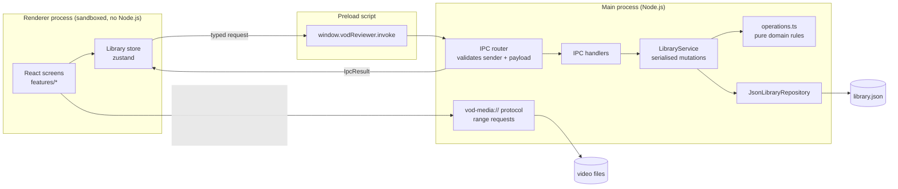

# Architecture

VOD Reviewer is an Electron desktop app. Electron splits an app into processes with very
different privileges, and the structure of this codebase follows that split.



## Source layout

```
src/
  shared/            Code both processes use. No Electron, no DOM.
    domain/          schema (zod), constants, roster, frame + time maths
    ipc/             the typed IPC contract
    media.ts         vod-media:// URL helpers
  main/              Main process: everything that touches the disk
    library/         operations (pure rules), repository (JSON), service
    ipc/             handlers + the router that guards them
    media/           the streaming protocol
    agent/           the summarize agent harness: MCP endpoint, tools, launcher, YouTube search
    email/           summary emails: HTML content, SMTP sender, encrypted credential store
    framedata/       frame data: Dustloop API client, on-disk cache, punish calculation
    videos/          directory browser, path safety
  preload/           The one bridge function exposed to the renderer
  renderer/src/      The React app
    app/             routes, layout, theming, settings, error boundary
    components/      generic UI: Button, Dialog, Icon, Stepper, Toaster
    features/
      library/       matchup grid, folder page, folder picker, dialogs
      import/        steps 1-2: pick a video, choose a matchup
      focus/         step 3: mark focus points
      review/        step 4: the main review workspace
      player/        the media player (hooks + components)
      annotations/   notes and timestamps
      review-notes/  each video's notes and AI summary, grouped by character
      email/         email setup dialog and the "Email" button
      frame-data/    the Frame data tab of the review screen
      characters/    portraits and folder labels
    store/           library store, selectors, toasts
    lib/             small utilities
    styles/          design tokens and global CSS
scripts/             character art fetcher, icon generator, end-to-end smoke test
build/               installer resources (app icon); electron-builder.yml is the config
resources/           files bundled into the main process (window icon, the agent's skill)
```

Dependencies point one way: `renderer -> shared <- main`. Features may use `components`,
`store`, `lib` and other features' public components, but `components` and `lib` never
import from `features`.

## The main process owns the data

There is exactly one writer of `library.json`: `LibraryService` in the main process.

1. The renderer asks for a change (`notes:create`, `videos:update`, ...).
2. The router checks the request came from the app's own page and validates the payload
   against the zod schema for that channel.
3. The handler runs a **pure function** from `operations.ts` that takes the current
   library and returns the next one, or throws a `DomainError` if a rule is broken.
4. `LibraryService` writes the result to disk and only then makes it the current state.
   Mutations are queued, so two requests can never interleave.
5. The handler answers with the new library snapshot, and the renderer's store replaces
   its copy with it.

Consequences worth knowing:

- **The UI cannot show unsaved data.** State only changes after the write succeeded.
  There is no "save" button and nothing to lose when the window closes.
- **Domain rules are testable without Electron or React** - see `operations.test.ts`.
- **The whole library crosses IPC on every change.** That is a deliberate trade of a few
  kilobytes for simplicity; see [ADR 0002](decisions/0002-json-library-owned-by-main-process.md)
  for when to revisit it.

Writes are atomic (temp file + rename, with retries for files briefly locked by other
programs), and an unreadable file is set aside rather than overwritten.

One kind of change does not start in the window: the summarize agent handing in a
summary. For that the main process pushes the new snapshot to the renderer
(`onLibraryChanged`), and the store replaces its copy exactly as it does after a request.
Outcomes of background work that nobody is waiting on - a summary being emailed
automatically, or failing to - arrive the same way as a `Notice` and are shown as a toast.

## The summarize agent

Summaries are written by the GitHub Copilot CLI, which the app starts in a
terminal window and serves through a loopback MCP endpoint with three narrow tools. The
agent is treated as untrusted in the same way the renderer is: it gets no file access and
can only read one video's notes and write one summary. The details are in
[agent-harness.md](agent-harness.md).

## The IPC contract

[`src/shared/ipc/contract.ts`](../src/shared/ipc/contract.ts) is the single definition of
what the renderer may ask for. Each channel has a zod request schema and a response type;
`IpcRequest<C>` and `IpcResponse<C>` are derived from them. The main process's handler map
is typed as "one handler per channel", so adding a channel without implementing it - or
calling one with the wrong payload - does not compile.

Failures are returned as data (`{ ok: false, error: { code, message } }`) because Electron
strips custom properties from errors thrown across IPC. `lib/api.ts` turns them back into
`ApiError`s in the renderer.

## Security posture

The renderer is treated as untrusted, the way a web page would be:

- `contextIsolation: true`, `sandbox: true`, `nodeIntegration: false`.
- The preload script exposes a single function and forwards to a single IPC channel.
- Every request is checked for its sender and validated before it reaches a handler.
- A strict Content-Security-Policy; the renderer loads no remote content at all. The
  main process makes the app's only outgoing requests: YouTube search and Dustloop frame
  data (both read-only, no account), and SMTP when a summary is emailed.
- Navigation away from the app and new windows are blocked.
- The agent endpoint listens on loopback only, serves each run at an unguessable URL,
  refuses browser-originated requests, and exposes nothing but that run's three tools.
- Summaries are rendered from markdown to React elements; HTML inside them is not executed.
  The same text is escaped again when it is put into an email.
- The email password is entered in a password field, sent once to the main process, and
  stored encrypted by the operating system. It is never written to `library.json`, never
  returned to the renderer, and only transmitted to the mail server over TLS.
- The renderer never receives `file://` access. Videos are served by the `vod-media://`
  protocol, which only resolves (a) videos that are in the library and (b) supported video
  files inside the configured videos folder. See [ADR 0003](decisions/0003-custom-media-protocol.md).

## Frame data

`src/main/framedata` downloads move data from the Dustloop wiki's Cargo API, keeps one
JSON file per character in the user-data folder, and serves it to two consumers through
the same service: the **Frame data** tab of the review screen (over IPC, `frameData:get`) and
the summarize agent (the `frame_data` MCP tool). A copy is reused for a week and an old
one is served if a refresh fails. The renderer never talks to the network itself.

Move and hitbox pictures follow the same rule. The Frame data tab asks for
`vod-media://move-image/?file=<name>`; the protocol handler hands the name to the frame
data service, which looks the picture up through the wiki's `imageinfo` API the first
time, saves it under a hash of its name in `frame-data\images\`, and serves the saved
copy from then on. Names that do not look like image files are refused, and downloads
are only accepted from Dustloop's hosts. The page's CSP allows images from `'self'`,
`data:` and `vod-media:` only.
See [ADR 0012](decisions/0012-frame-data.md).

## Emailing summaries

`src/main/email` turns a finished summary into an HTML email and sends it over SMTP from
an account the user connects in Settings.

| Piece | Responsibility |
| --- | --- |
| `content.ts` | Pure: builds subject, HTML and plain text from the library. Markdown is rendered with inline styles; YouTube links become video cards. |
| `mailer.ts` | Sends through nodemailer, always over TLS, and turns SMTP failures into messages a person can act on. |
| `credentials.ts` | Stores the account password encrypted with the OS key store, outside the library. |
| `service.ts` | Ties them together: configure, remove, send a test, send a summary. |
| `portraits.ts` | Resolves a character's portrait file for the email header. |

The agent harness calls back when a summary is saved; if automatic sending is on, the
main process emails it then. See [ADR 0011](decisions/0011-email-summaries.md).

## The media player

The player is a set of hooks around a plain `<video>` element, in `features/player`:

| Piece | Responsibility |
| --- | --- |
| `usePlayer` | Playback state as React state, transport actions (play, seek, step frames, speed, volume). |
| `useCurrentTime` / `useCurrentFrame` / `useActiveItemId` | The playhead as an external store (`useSyncExternalStore`). |
| `useZoomPan` + `zoom.ts` | Wheel-to-zoom towards the cursor and drag-to-pan; the maths is pure and unit-tested. |
| `useFrameRateDetection` | Measures the real frame rate during playback. |
| `usePlayerShortcuts` | Keyboard shortcuts. |
| `useVideoWorkspace` | Wires the above to a library video and keeps its stored duration and frame rate up to date. |
| `VideoStage`, `Timeline`, `TransportBar`, `PlayerSurface` | The visible parts. |

Two decisions shape it:

**The playhead is not React state.** It changes up to 60 times a second. Putting it in
state high in the tree would re-render the whole review screen on every frame. Instead
components that need it subscribe individually: the time readout re-renders every frame,
the notes list re-renders only when the *active note* changes, and everything else not at
all.

**Frame stepping is computed, not native.** Browsers expose time in seconds, not frames.
Stepping converts the current time to a frame index and seeks to the *middle* of the
neighbouring frame, which is immune to floating-point rounding at frame boundaries. This
is only exact if the frame rate is right, hence the detection hook.
See [ADR 0004](decisions/0004-frame-stepping-and-frame-rate-detection.md).

## State management

- **Server-like state** (the library) lives in one small zustand store that mirrors the
  main process. Screens derive what they need with pure selectors wrapped in `useMemo`.
- **UI state** (open dialog, active tab, draft text, zoom) is local `useState`.
- **Workflow position** is the URL: `/import` -> `/videos/:id/focus` -> `/videos/:id/review`.
  The focus and review screens work from the stored video, so they double as "edit focus
  points" and "continue reviewing" later.

## Testing

| Layer | Tool | What it covers |
| --- | --- | --- |
| Domain rules, frame/time/zoom maths, range parsing, persistence, the agent protocol and tools, email content and delivery | Vitest (`npm test`) | Pure logic, the JSON repository against a temp directory, and real SMTP delivery to a local test server. |
| The whole app | Playwright driving Electron (`npm run test:e2e`) | The real built app through the full workflow, against a generated test video and throwaway data. The test plays the summarize agent itself, so no AI credits are spent, and runs its own mail server, so no real email is sent. |
| Types and conventions | `npm run typecheck`, `npm run lint` | Strict TypeScript and type-aware ESLint, including the React Compiler-era hooks rules. |

## Decisions

The reasoning behind the larger choices is recorded in [`docs/decisions`](decisions/README.md).
