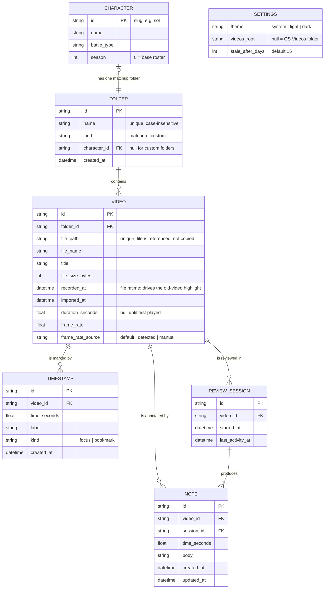

# Data model

The library is stored as **one JSON document**, `library.json`, in the app's user-data
folder (`%APPDATA%\vod-reviewer\library.json` on Windows). It is shaped like a relational
database on purpose: every entity is a flat record in its own array, and records point at
each other **by id only** - nothing is nested. Moving to a real database is therefore a
mechanical exercise: each array becomes a table, each `...Id` field becomes a foreign key.

The schema is defined once, in [`src/shared/domain/schema.ts`](../src/shared/domain/schema.ts),
with [zod](https://zod.dev). The TypeScript types are inferred from it and the file is
validated against it every time it is loaded.

## Entity-relationship diagram



`SETTINGS` is a singleton (one row, or a key-value table). `CHARACTER` is reference data
that ships with the app in [`characters.ts`](../src/shared/domain/characters.ts); it is not
stored in `library.json`, but it would be a seeded lookup table in a database.

## Entities

| Entity | JSON key | What it is |
| --- | --- | --- |
| Folder | `folders` | Where a video is filed. One built-in `matchup` folder per character (id `matchup-<characterId>`), plus any `custom` folders the user creates. |
| Video | `videos` | A recording on disk that was added to the library. Belongs to exactly one folder. |
| Timestamp | `timestamps` | A named position in a video. `focus` points are set in the import flow ("where should this review concentrate?"); `bookmark`s are added while reviewing. Clicking one seeks the video. |
| Review session | `sessions` | One sitting of note-taking on a video. Created with the first note written after opening the review screen. |
| Note | `notes` | Free text pinned to a position in a video, written during a session. |
| Settings | `settings` | Theme, the import browser's root folder, and the "old video" threshold. |

## Rules the application enforces

These live in [`src/main/library/operations.ts`](../src/main/library/operations.ts) and are
unit-tested. In a database most of them become constraints.

| Rule | Database equivalent |
| --- | --- |
| A video's folder must exist. | `FOREIGN KEY (folder_id)` |
| A file can only be in the library once (compared case-insensitively on Windows/macOS). | `UNIQUE (file_path)` with a case-insensitive collation |
| Folder names are unique, ignoring case. | `UNIQUE (lower(name))` |
| Matchup folders cannot be renamed or deleted. | Application rule / trigger on `kind = 'matchup'` |
| A custom folder can only be deleted when empty. | `ON DELETE RESTRICT` on `video.folder_id` |
| Removing a video removes its timestamps, sessions and notes. | `ON DELETE CASCADE` |
| A note's session must belong to the same video as the note. | Composite FK `(session_id, video_id)` |
| A session never exists without notes: deleting its last note deletes it. | Application rule / trigger |
| New characters in the roster get a matchup folder on next launch. | Seed migration |

`Note.videoId` is deliberately redundant with `Note.sessionId -> ReviewSession.videoId`.
Notes are read per video far more often than per session, and the duplication keeps that
read a single filter (and, later, a single indexed lookup) instead of a join.

## Example file

```json
{
  "schemaVersion": 1,
  "settings": { "theme": "dark", "videosRoot": null, "staleAfterDays": 15 },
  "folders": [
    { "id": "matchup-sol", "name": "Sol Badguy", "kind": "matchup", "characterId": "sol", "createdAt": "2026-11-14T09:00:00.000Z" },
    { "id": "5f0c...", "name": "Tournament sets", "kind": "custom", "characterId": null, "createdAt": "2026-11-14T09:30:00.000Z" }
  ],
  "videos": [
    {
      "id": "a41e...",
      "folderId": "matchup-sol",
      "filePath": "C:\\Users\\me\\Videos\\ranked-set.mp4",
      "fileName": "ranked-set.mp4",
      "title": "ranked-set",
      "fileSizeBytes": 1218530683,
      "recordedAt": "2026-10-30T22:50:01.000Z",
      "importedAt": "2026-11-14T09:05:00.000Z",
      "durationSeconds": 1204.5,
      "frameRate": 60,
      "frameRateSource": "detected"
    }
  ],
  "timestamps": [
    { "id": "c9b2...", "videoId": "a41e...", "timeSeconds": 183.4, "label": "Round 2 - lost neutral", "kind": "focus", "createdAt": "2026-11-14T09:06:00.000Z" }
  ],
  "sessions": [
    { "id": "77d0...", "videoId": "a41e...", "startedAt": "2026-11-14T09:10:00.000Z", "lastActivityAt": "2026-11-14T09:25:00.000Z" }
  ],
  "notes": [
    { "id": "e3aa...", "videoId": "a41e...", "sessionId": "77d0...", "timeSeconds": 191.75, "body": "Dropped the combo after 6P - practise the route", "createdAt": "2026-11-14T09:12:00.000Z", "updatedAt": "2026-11-14T09:12:00.000Z" }
  ]
}
```

## Porting to a database

A PostgreSQL/SQLite-flavoured sketch of the same model:

```sql
CREATE TABLE character (
  id          TEXT PRIMARY KEY,
  name        TEXT NOT NULL,
  battle_type TEXT NOT NULL,
  season      INTEGER NOT NULL
);

CREATE TABLE folder (
  id           TEXT PRIMARY KEY,
  name         TEXT NOT NULL,
  kind         TEXT NOT NULL CHECK (kind IN ('matchup', 'custom')),
  character_id TEXT UNIQUE REFERENCES character (id),
  created_at   TIMESTAMPTZ NOT NULL,
  CHECK ((kind = 'matchup') = (character_id IS NOT NULL))
);
CREATE UNIQUE INDEX folder_name_unique ON folder (lower(name));

CREATE TABLE video (
  id                TEXT PRIMARY KEY,
  folder_id         TEXT NOT NULL REFERENCES folder (id) ON DELETE RESTRICT,
  file_path         TEXT NOT NULL UNIQUE,
  file_name         TEXT NOT NULL,
  title             TEXT NOT NULL,
  file_size_bytes   BIGINT NOT NULL,
  recorded_at       TIMESTAMPTZ NOT NULL,
  imported_at       TIMESTAMPTZ NOT NULL,
  duration_seconds  DOUBLE PRECISION,
  frame_rate        DOUBLE PRECISION NOT NULL DEFAULT 60,
  frame_rate_source TEXT NOT NULL DEFAULT 'default'
                    CHECK (frame_rate_source IN ('default', 'detected', 'manual'))
);
CREATE INDEX video_folder_recorded ON video (folder_id, recorded_at DESC);

CREATE TABLE "timestamp" (
  id           TEXT PRIMARY KEY,
  video_id     TEXT NOT NULL REFERENCES video (id) ON DELETE CASCADE,
  time_seconds DOUBLE PRECISION NOT NULL CHECK (time_seconds >= 0),
  label        TEXT NOT NULL DEFAULT '',
  kind         TEXT NOT NULL CHECK (kind IN ('focus', 'bookmark')),
  created_at   TIMESTAMPTZ NOT NULL
);
CREATE INDEX timestamp_video_time ON "timestamp" (video_id, time_seconds);

CREATE TABLE review_session (
  id               TEXT PRIMARY KEY,
  video_id         TEXT NOT NULL REFERENCES video (id) ON DELETE CASCADE,
  started_at       TIMESTAMPTZ NOT NULL,
  last_activity_at TIMESTAMPTZ NOT NULL,
  UNIQUE (id, video_id)
);

CREATE TABLE note (
  id           TEXT PRIMARY KEY,
  video_id     TEXT NOT NULL REFERENCES video (id) ON DELETE CASCADE,
  session_id   TEXT NOT NULL,
  time_seconds DOUBLE PRECISION NOT NULL CHECK (time_seconds >= 0),
  body         TEXT NOT NULL,
  created_at   TIMESTAMPTZ NOT NULL,
  updated_at   TIMESTAMPTZ NOT NULL,
  FOREIGN KEY (session_id, video_id) REFERENCES review_session (id, video_id) ON DELETE CASCADE
);
CREATE INDEX note_video_time ON note (video_id, time_seconds);

CREATE TABLE settings (
  id               INTEGER PRIMARY KEY CHECK (id = 1),
  theme            TEXT NOT NULL DEFAULT 'system' CHECK (theme IN ('system', 'light', 'dark')),
  videos_root      TEXT,
  stale_after_days INTEGER NOT NULL DEFAULT 15 CHECK (stale_after_days >= 1)
);
```

What changes in the code when that day comes:

1. **One new class.** Persistence sits behind the `LibraryRepository` interface in
   [`repository.ts`](../src/main/library/repository.ts). A `SqliteLibraryRepository` (or a
   client for a remote API) replaces `JsonLibraryRepository`; nothing in the renderer changes.
2. **Granular writes.** Today every change rewrites the whole (small) file. The operations
   in `operations.ts` already describe each change precisely, so each maps onto one
   `INSERT`/`UPDATE`/`DELETE` in a transaction.
3. **A user dimension, if the app is ever shipped as a service.** Add a `user` table and a
   `user_id` on `folder`, `video` and `settings`; everything else hangs off those.
4. **`file_path` stops being enough.** A hosted version would store an object-storage key
   (and probably a content hash) instead of a local path.

## Versioning

`schemaVersion` is checked on load. A file written by a newer version of the app is
refused rather than guessed at, and `migrate()` in `repository.ts` is the place where
`1 -> 2` style upgrades go. A file that cannot be parsed is **renamed**
(`library.unreadable-<timestamp>.json`), never overwritten, so a bad edit or a bug can
not destroy notes.
